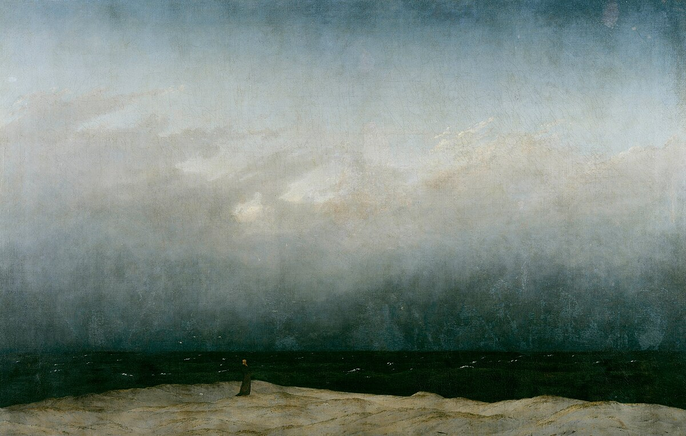

# nils.me

My personal website. React + [nils/ui](https://ui.nils.me), prerendered to static HTML.

```bash
bun install      # expects the ui repo checked out at ../ui
bun run dev      # http://localhost:5173
bun run build    # static site in dist/
```

The listening row reads Spotify's scrobbles from Last.fm (user `okaynils`) straight from the browser; the key in `src/components/listening-now.tsx` is Last.fm's public, read-only kind.

## Pages

- `/`: intro, what I'm working on, writing, playlists (`src/pages/home.tsx`)
- `/about`: cornerstones, likes, values, links (`src/pages/about.tsx`)
- `/notes/<slug>`: one per file in `content/notes/`

## Writing a note

Add `content/notes/<slug>.md`:

```md
---
title: a lowercase title
date: 2026-10-30
---

Text. An image on its own line becomes a figure, captioned with its alt text:


```

It shows up on the home page, in `feed.xml`, and gets older/newer links. Images go in `public/images/posts/`.
